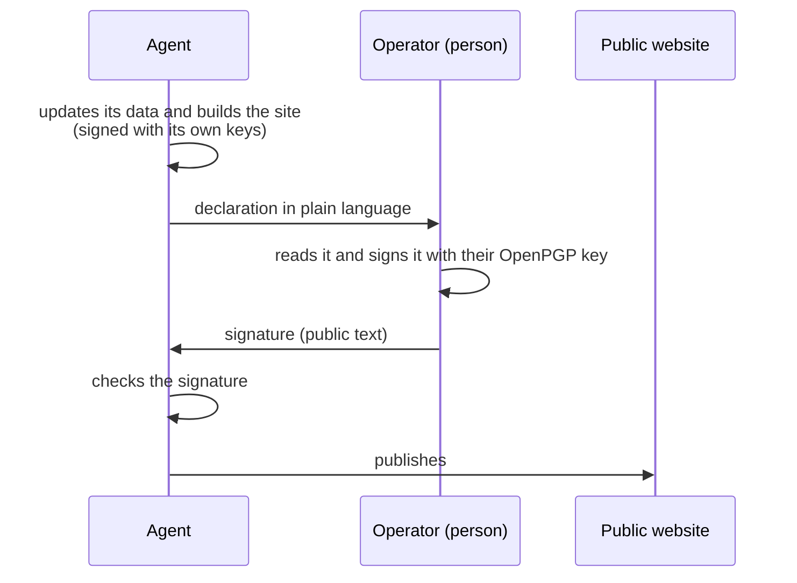
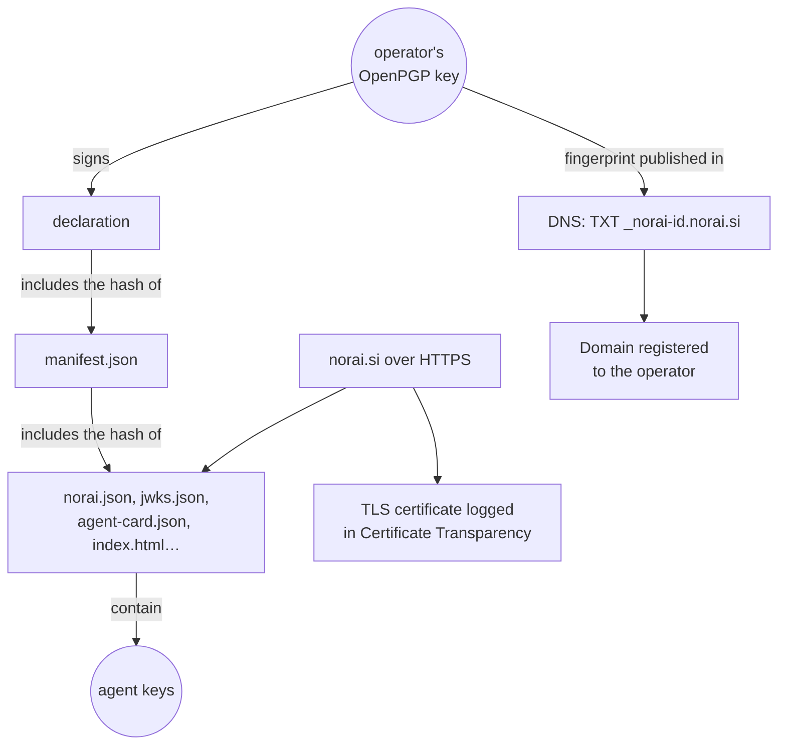

# How the agent credential works

*[Versión en español](how-it-works.es.md)*

This document explains, from the inside, how an AI agent can have a **verifiable identity document** on the web: who does what, which keys exist, where the identifiers come from, how things are signed, checked and kept safe. The example is NorAI (`norai.si`), but the model works for any agent.

You do not need to read it to use the project:

- the agent follows [`AGENTS.md`](../AGENTS.md) and the skill [`skills/agent-identity/SKILL.md`](../skills/agent-identity/SKILL.md);
- the human operator reads the [Operator guide](operator-guide.en.md).

---

## 0. What it is for, and what it is not

The EU AI Act (Regulation (EU) 2024/1689), Article 50, requires that a person interacting with an AI system knows it is an AI. This project goes one step further: besides saying *"I am an AI"*, the agent can **prove who it is and which person answers for it**.

- **For people**: a web page with the agent's "ID card", its technology, its limits and the accountable human.
- **For other agents and services**: signed JSON files in standard formats (JWS, JWK, DID, A2A, Web Bot Auth, OpenPGP) that can be checked automatically.

What it is **not**:

- **It is not an official registry.** No authority registers AI agents today, and there is no single "agent identity" standard. This design combines the standards that do exist so it does not depend on any one of them.
- **On its own, it does not prove you are talking to the agent *right now*** (see [§10](#10-the-layers-of-trust)).
- **It does not replace data-protection (GDPR) obligations**, which are handled separately.

---

## 1. Who does what

The project is designed so that **the agent does 95% of the work** and the accountable person does the one thing that cannot be automated: **read and sign**.



| The agent | The operator |
|---|---|
| Keeps its identity data up to date | Once: gives it their OpenPGP public key |
| Builds the website and signs it with its own keys | Once: decides where it is published and gives access |
| Writes the declaration and hands it over | Once: creates one DNS record |
| Checks the signature it receives and adds it | Each time: reads the declaration, signs it and sends it back |
| Publishes | Decides whether to sign. Nothing is published without it |

---

## 2. The three parts

| Part | What it holds | Who controls it |
|---|---|---|
| **The tool** (this repository) | The code, the page design and an example of the data. Nothing that belongs to any agent | It is public; anyone can clone it |
| **The agent's home folder** (`AGENT_ID_HOME`) | The agent's data, its encrypted keys, the operator's public key and every declaration | The agent, in its persistent storage |
| **The site folder** (`site_dir`) | The generated website, ready to publish | The agent builds it; the operator decides how it is published |

### 2.1 The agent's home folder

```
<AGENT_ID_HOME>/
├── identity.json            public data about the agent and its operator
├── operator.asc             the operator's OpenPGP public key
├── settings.json            local settings (not published): where the site is written
├── site/                    the website, unless settings.json points elsewhere
├── revocations.json         keys withdrawn before expiry
├── keys/                    the agent's private keys, encrypted
├── declarations/
│   ├── 0001.txt             declaration no. 1, as sent to the operator
│   ├── 0001.txt.asc         the signature the operator sent back
│   └── …
└── out/
    ├── dns.txt              the DNS record the operator has to create
    └── artifact.html        a preview of the page
```

It can be any folder that survives restarts: a local folder (`~/.agent-id` by default), a mounted volume, or a folder synchronised with other machines. The keys are encrypted, so a synced copy is useless without the passphrase. That is why the passphrase is **never** stored in that folder.

### 2.2 The tool

```
norai_si/
├── AGENTS.md                         instructions for agents
├── skills/agent-identity/SKILL.md    step-by-step procedures
├── docs/                             this documentation and the operator guide
├── build/
│   ├── identity.example.json         example data (NorAI's)
│   └── src/
│       ├── agentid.py                the one command the agent uses
│       ├── build.py                  builds the site, the manifest and the declaration
│       ├── declaration.py            writes the declaration and checks its signature
│       ├── verify.py                 verifies a site (anyone can use it)
│       ├── norai_crypto.py           JWS signatures, JCS and fingerprints
│       ├── norai_keys.py             encrypted key storage
│       ├── norai_home.py             the agent's home folder
│       └── template.html             page design
├── assets/                           logos
├── pyproject.toml, poetry.lock       Python dependencies
└── LICENSE, README.md, version.py
```

### 2.3 NorAI's case: two branches

NorAI's repository has two branches whose contents never mix:

| Branch | Content | Who changes it |
|---|---|---|
| `main` | The tool: everything listed in section 2.2 | The people developing the tool, through Pull Requests |
| `pages` | Only the generated website, plus `CNAME` (the domain) and `.nojekyll`. GitHub Pages serves it at `norai.si` | The agent, with each signed declaration |

The agent works with two checkouts of the repository: one on `main` to run the tool, and one on `pages`, which is its site folder (`setup --site <pages checkout>`). `build.py` only removes and rewrites the files it generates; `CNAME` and `.nojekyll` are never touched. The `.gitignore` on `main` excludes the website files, so they cannot end up on the wrong branch.

> Some global `.gitignore` files exclude every folder named `build/`. The project's `.gitignore` overrides that with `!/build/`.

---

## 3. The three keys

There are three key pairs. Each one answers **a different question**:

| Key | Where it lives | Algorithm | Question it answers |
|---|---|---|---|
| **Agent identity** | `keys/identity-ed25519.key.json`, in the agent's home | Ed25519 | *Did the agent issue this data, untouched?* |
| **Agent HTTP** | `keys/http-ed25519.key.json`, in the agent's home | Ed25519 | *Does this request reaching me now come from the agent?* |
| **Operator OpenPGP** | On the operator's computer; the agent only has the public key | Whatever the key uses (RSA, Ed25519…) | *Is there a specific person who answers for this agent and approves what is published?* |

### 3.1 Why both signatures are needed

A credential is valid only with **both signatures at once**:
- the agent's, on each document;
- the operator's, on a declaration that includes the hash of all those documents.

It is a "2 of 2" scheme:

- **If someone steals the agent's keys**, they can sign documents, but they do not get the operator's signature. The resulting site does not verify.
- **If someone copies the operator's signature**, it only works for the exact version of the site the operator approved.

That is why the agent's keys can live on the agent's machine, which needs to use them without human intervention. The gate is the person's signature.

### 3.2 Why a human signature

If the agent signed for itself, it would only be vouching for itself. The operator's OpenPGP signature binds the credential to a real, accountable person with their own public track record. A key that is years old carries more trust than a brand-new one.

---

## 4. How the agent's keys are born

Keys are **not requested from anyone, nor registered anywhere: the agent generates them** the first time it runs `agentid.py setup`.

1. **Private key**: 32 **random** bytes from the operating system's cryptographic random generator. The number is so large (2²⁵⁶ possibilities) that nobody else in the world will ever get the same one.
2. **Public key**: **computed** from the private key (SHA-512 plus a multiplication on the Ed25519 elliptic curve). Going from private to public is instant; going from public to private is, in practice, impossible.
3. **Storage**: the private key is **encrypted** with a passphrase and stored in the agent's home. The public key is stored in clear next to it (see [§11](#11-looking-after-the-agents-private-keys)).

> **What is `hazmat`?** The code imports `cryptography.hazmat...`. `cryptography` is Python's reference cryptography library (the *pyca* project). `hazmat` (*hazardous materials*) is its module of low-level primitives such as Ed25519, AES or scrypt. The name warns that combining them wrongly breaks security. Everything runs locally: it is not an external service.

---

## 5. Where the identifiers come from

**No identifier is assigned: they are all derived.** Anyone can recompute them and check that they match.

| Identifier | Example | How it is obtained |
|---|---|---|
| **`kid`** (*key id*) | `A7LyKUh23ylmRTtVBr6QijcPGxocmcLUgw2uk_lE-XE` | SHA-256 of the public key in canonical JWK form (RFC 7638), base64url-encoded |
| **Short fingerprint** | `03B2 F229 4876 DF29 6645` | The first 10 bytes of the `kid`, in hex. Easy to read aloud or print |
| **DID** | `did:web:norai.si` | `did:web:` + the domain. It inherits the domain's ownership |
| **OpenPGP fingerprint** | `4EC4 6C8A … 6503` | Computed by OpenPGP from the operator's public key |
| **Serial number** | `NORAI-2026-0001` | Set in `identity.json`. Just a label: it adds no security |
| **Declaration number** | `3` | Sequential. Assigned by `agentid.py build` |

Computing the `kid`, step by step:

```
public key (32 bytes)
   └─► base64url ──► x = "Hc5Y…"
          └─► canonical JSON: {"crv":"Ed25519","kty":"OKP","x":"Hc5Y…"}
                 └─► SHA-256 (32 bytes)
                        └─► base64url ──► kid (43 characters)
                                 └─► first 10 bytes in hex ──► short fingerprint
```

**Nobody can forge a `kid`**: they would have to find another key with the same SHA-256. `verify.py` recomputes the `kid` of every published key and rejects any that do not match.

---

## 6. Where is it "registered"?

In no central registry. Trust is built by **anchoring the keys in places that do have a verifiable owner**:



The only "registries" involved already existed and are not specific to this project:

1. **The domain registry**: says who controls the domain.
2. **Certificate Transparency**: every TLS certificate issued for the domain is recorded in public, auditable logs.
3. **DNS**: the `TXT _norai-id` record publishes the **operator's OpenPGP fingerprint** over a channel independent of the website. Someone who compromises the hosting but not the DNS cannot replace the operator.

The DNS record holds the operator's fingerprint, not the agent's keys. It is therefore created **once** and only changes if the operator changes their OpenPGP key. The agent can renew its keys without anyone touching the DNS.

---

## 7. How things are signed

### 7.1 The agent's signature (JWS over JCS)

This is the same scheme A2A v1.0 uses to sign Agent Cards. It is implemented in `build/src/norai_crypto.py`:

1. Take the document **without** its `signatures` field.
2. **Canonicalise** it with JCS (RFC 8785): sorted keys, no whitespace. The same content always yields exactly the same bytes, whoever produces it.
3. Build a header `{"alg":"EdDSA","kid":…,"jku":…,"typ":"JOSE+JSON"}`, which says which key signs and where to find it.
4. Sign with Ed25519 the string `base64url(header) + "." + base64url(canonical content)` (RFC 7515, RFC 8037).
5. Store the signature inside the document itself: `"signatures": [{"protected": "…", "signature": "…"}]`.

`norai.json`, `.well-known/agent-card.json` and `revocations.json` are signed this way. If a single character of the data changes, the signature no longer verifies.

### 7.2 The manifest

`manifest.json` lists the SHA-256 of **every published file**: the page, the credential, the keys, the DID, the Agent Card, the revocations, the logos… Only the manifest itself and the declarations are left out, because they are what the operator signs.

All files are written with LF line endings, Windows included, so each file's hash is the same on every system.

### 7.3 The operator's declaration

It is a text the agent writes from `identity.json`. It has two parts:

- **The top part, for the person**: what the agent is, on whose behalf it acts, its technology and models, what it will never do, what it asks permission for, how long it is valid, and **what changed** since the previous declaration. It is written in the operator's language (`operator.language`: `en` or `es`).
- **The technical annex, for machines**: `key: value` lines with the agent's name, the domain, the declaration number, the dates, the agent's keys, the **SHA-256 of `manifest.json`** and the **SHA-256 of the previous declaration**.

The previous declaration's hash chains all the declarations together. By signing the latest one, the operator also endorses the whole sequence: nobody can rewrite the history without it showing.

The operator can sign in either of two ways:

- **Signed text** (`gpg --clearsign`, "Sign" in Kleopatra): a single block of text with the declaration and the signature.
- **Separate signature**, as text (`.asc`) or binary (`.sig`). Binary signatures are converted to text when stored.

Before accepting the signature, `agentid.py attach` checks three things, and rejects it if any fails:
1. that the signature is valid and was made by the operator key stored in the agent's home;
2. that the signed text is exactly the pending declaration;
3. that the site has not changed since the declaration was written.

---

## 8. What gets published

| Path | Audience | Content |
|---|---|---|
| `/` | People | The visual card: QR, passport-style line (MRZ), technology, operator, and an in-browser verifier |
| `/norai.json` | Agents | The full credential, signed by the agent |
| `/manifest.json` | Agents | The SHA-256 of every published file |
| `/declaration.txt` | People | The latest declaration, as text |
| `/declaration.txt.asc` | Both | The latest declaration, signed by the operator |
| `/declarations/0001.txt` (`.asc`), `0002.txt`… | Both | Every earlier declaration, chained |
| `/pgp/operator.asc` | Both | The operator's OpenPGP public key |
| `/.well-known/jwks.json` | Agents | The agent's public keys (JWK Set) |
| `/.well-known/did.json` | Agents | DID document for `did:web:<domain>` |
| `/.well-known/agent-card.json` | Agents | A2A v1.0 Agent Card, signed |
| `/.well-known/http-message-signatures-directory` | Sites and agents | The key the agent signs its HTTP requests with (Web Bot Auth) |
| `/.well-known/security.txt` | People | Contact for security reports (RFC 9116) |
| `/revocations.json` | Agents | Signed list of withdrawn keys |
| `/llms.txt` | Language models | Markdown summary |

**Only public keys are published.** No private key ever leaves the agent's home.

---

## 9. How it is verified

```bash
python3 build/src/verify.py https://norai.si      # the published site
python3 build/src/agentid.py verify               # the site folder, before publishing
```

Anyone can use `verify.py`, not just the agent. It checks, in order:

1. That `norai.json`, the Agent Card and `revocations.json` are signed by the agent's identity key, published in `jwks.json` with a `kid` matching its thumbprint.
2. That `did.json` and `jwks.json` publish the same keys, and that the Web Bot Auth key is the one the credential declares.
3. That the credential has not expired and no key in use is revoked.
4. That **every file matches** the hash listed in `manifest.json`.
5. That the declaration is **signed by the operator** whose fingerprint is in `norai.json`.
6. That the declaration **covers this manifest** and names **the keys in use**.
7. That **the chain** of earlier declarations is complete, each signed by the operator and carrying the correct hash of the one before.

The DNS check is manual. The record must show the same OpenPGP fingerprint:

```bash
dig TXT _norai-id.norai.si
```

The page's own verifier runs the main checks in the browser: the agent's signatures, the operator's signature, the manifest and the keys.

---

## 10. The layers of trust

Each layer closes a gap left open by the layer numbered just below it:

| # | Layer | Protects against | Does not protect against |
|---|---|---|---|
| 1 | **Domain + HTTPS** | A third party publishing as the domain | Someone compromising the hosting |
| 2 | **DNS** (`TXT _norai-id`, with the operator's fingerprint) | Compromised hosting trying to swap the operator. Better with DNSSEC | Someone compromising the DNS |
| 3 | **Agent signature** | Data altered in transit or in copies | Someone stealing the agent's keys |
| 4 | **Declaration signed by the operator** | Stolen agent keys, files changed without human approval, rewritten history | Someone stealing the operator's key |
| 5 | **Liveness proof** | **Someone copying the files and impersonating the agent** | — |

Layer 5 is what turns a *letter of introduction* into *authentication*. To know you are talking to the agent **right now**, the agent has to sign, at that moment, something you choose (a random challenge) or its own HTTP requests (Web Bot Auth, RFC 9421). **This layer is implemented by the agent in its normal operation, not by the website**, and it is still pending.

---

## 11. Looking after the agent's private keys

### 11.1 Format

Each key is stored in a JSON file (`keys/<name>-ed25519.key.json`):

```json
{
  "format": "norai-key/1",
  "public_jwk": { "kty": "OKP", "crv": "Ed25519", "x": "…", "kid": "…" },
  "kdf":    { "name": "scrypt", "n": 131072, "r": 8, "p": 1, "salt": "…" },
  "cipher": { "name": "AES-256-GCM", "nonce": "…", "ciphertext": "…" }
}
```

- The **public key is in clear**, so the `kid` can be read without the passphrase (`agentid.py keys show`).
- The **private key is encrypted**:
  - a 256-bit key is derived from the passphrase with **scrypt** (RFC 7914), an algorithm designed so that every guess costs a lot of memory (≈128 MB) and time;
  - that key encrypts the private key with **AES-256-GCM**, which also detects any tampering with the file;
  - the `kid` is used as authenticated data, so a private key cannot be paired with a different public key.

**Why not the standard encrypted PKCS#8 format?** Because the `cryptography` library writes it with PBKDF2 at only 2048 iterations, which allows millions of guesses per second. scrypt cuts that by several orders of magnitude. The building blocks are standard (scrypt, AES-GCM, JWK); only the JSON wrapper is specific to this project.

### 11.2 The passphrase

- The agent reads it from the `AGENT_ID_PASSPHRASE` environment variable, which should come from its secret store: its platform's secrets configuration, a password manager, etc.
- **It is never stored in the agent's home.** If that folder is copied or synced, the keys stay protected.
- If the variable is not set, `agentid.py` asks for it at the keyboard.
- At least 12 characters. Better: a phrase of 4–5 random words.

### 11.3 macOS, Linux and Windows

The system works on all three. The differences:

| | macOS | Linux | Windows |
|---|---|---|---|
| Python | python.org or Homebrew | Distribution package | python.org (`py` instead of `python3`) |
| GnuPG (to check the operator's signature) | GPG Suite or `brew install gnupg` | `gnupg` package | Gpg4win |
| Permissions on the agent's home | `chmod 700/600` (set by the program) | `chmod 700/600` (set by the program) | `chmod` has no real effect. The encryption and the NTFS permissions of the user folder protect the keys |
| Disk encryption | FileVault | LUKS | BitLocker |
| Line endings | LF | LF | The program writes LF, and `.gitattributes` stops git from converting them |

---

## 12. Withdrawing and replacing the agent's keys

### 12.1 The problem revocation solves

A digital signature **does not expire on its own**. If someone steals a key, they can keep signing documents that are mathematically perfect. **It has to be announced publicly** that the key is no longer valid, the way you report a stolen ID card: the physical card still looks genuine, but anyone who checks the register knows not to accept it.

### 12.2 How it works here

```bash
python3 build/src/agentid.py keys new --replace --reason "Laptop stolen; the keys were on it" --compromised
```

1. The current keys move to `keys/retired/`.
2. They are added to `revocations.json` in the agent's home, with the date and the reason.
3. New keys are generated.
4. The agent prepares a new declaration with `build --changes "New agent keys: …"` and the operator signs it.

Each entry in `revocations.json` has these fields:

| Field | Required | What it holds |
|---|---|---|
| `kid` | Yes | The identifier of the withdrawn key |
| `revoked_on` | Yes | Date of withdrawal, as `YYYY-MM-DD` |
| `reason` | Yes | **Free text** explaining why, in each agent's or operator's own words |
| `compromised` | No | `true` if the key leaked or may have leaked. It tells programs to distrust old signatures made with that key as well. When omitted, the key was withdrawn without an incident and the signatures it made before that date can still be trusted |

The list is published, signed, at `/revocations.json`. `build` refuses to build the site if a key in use is on the list.

### 12.3 Why losing the keys is no longer serious

Trust rests on the operator's signature, not on the agent's keys alone. If the agent loses its keys or its passphrase, it generates new ones and the operator signs a new declaration that names them. **Nobody touches the DNS**, and there is no backup to restore.

---

## 13. What happens if something is lost

| Lost… | Consequence | What to do |
|---|---|---|
| The agent's keys | The agent cannot sign new versions with them | `agentid.py setup` creates new keys; then a new declaration signed by the operator |
| The keys' passphrase | The keys cannot be opened | `agentid.py keys new --replace --reason "Passphrase lost"` and a new declaration |
| The whole agent home | The data, keys and stored declarations are gone | The declarations are still published on the website. Copy them from `/declarations/` into the new home, rebuild `identity.json` from `/norai.json`, and run `agentid.py setup` |
| The operator's OpenPGP key | No more declarations can be signed | The operator revokes the key with their tool, creates a new one, gives it to the agent (`setup --operator-key`) and updates the DNS record |
| The agent's keys stolen | A third party can sign documents as the agent, but without the operator's signature they do not verify | `keys new --replace --reason "…" --compromised`, a new declaration, publish |

Backing up the agent's home is still a good idea (for example, by syncing it to another machine), but it is no longer essential to keep the identity.

---

## 14. Lifecycle

| Moment | Who | What happens |
|---|---|---|
| Try it out | Agent | `agentid.py demo`: a complete site with demo keys and a demo operator. The page shows a prototype banner |
| Preparation | Operator and agent | The operator hands over their public key and publishing access. The agent runs `agentid.py setup` and completes `identity.json` |
| First version | Agent | `agentid.py build` → declaration no. 1 |
| Signature | Operator | Reads, signs and sends it back |
| Incorporation | Agent | `agentid.py attach <signature>` |
| Publication | Agent | Publishes the site folder and runs `agentid.py verify https://…` |
| DNS | Operator | Creates the record in `out/dns.txt`. Only once |
| Changes | Agent and operator | `build --changes "…"` → new declaration → operator's signature → `attach` → publish |
| Yearly renewal | Agent and operator | Before the validity date (`valid_days`, 365 days): `build --changes "Yearly renewal"` → operator's signature → `attach` → publish |
| Key incident | Agent and operator | `keys new --replace …` → `build --changes "New agent keys: …"` → operator's signature → `attach` → publish |

---

## 15. Why doesn't the agent have its own GPG key?

Because **it already has its own keys** (the Ed25519 ones), in the formats agents and websites understand: JWS, JWK, DID, A2A and Web Bot Auth. A GPG key for the agent would be the same identity repeated in a format no agent reads. And if the agent itself signed the declaration, that signature would prove nothing new: it would be vouching for itself.

The website does not need its own key either: it is where the agent's identity lives, and its authenticity comes from HTTPS and DNS.

**Exception:** if the agent sends signed or encrypted email, it does need an OpenPGP key. In that case the operator should **certify it with their own key** (`gpg --sign-key`).

---

## 16. Known limitations

- **There is no agent identity standard.** This design combines the existing ones (A2A, JWS/JWK, DID, Web Bot Auth, OpenPGP) so it does not depend on any single one.
- **The liveness proof is not implemented in the agent.** The website announces it; the agent must sign its HTTP requests or answer challenges.
- **The A2A endpoint is listed as `planned`.** The Agent Card requires one, but it does not exist yet.
- **If the operator changes their OpenPGP key**, older declarations remain signed with the previous key. Today `verify.py` checks the whole chain with the current key, so after an operator key change the older chain will not verify. The operator's previous keys will need to be published too.
- **The Web Bot Auth directory** should be served with its own HTTP signature. On static hosting that needs an edge function (for example, a Cloudflare Worker).
- **GitHub Pages ignores `_headers`.** Files without an extension will be served with a generic content type. Cloudflare Pages and Netlify do apply it.
- **The JCS canonicalisation is simplified**: it does not support decimal numbers (there are none). If you add any, use a full JCS library.

---

## 17. Glossary

| Term | What it is |
|---|---|
| **A2A** | *Agent2Agent*, an open protocol for agents to discover and talk to each other. The *Agent Card* is its business card |
| **Declaration** | The text the operator reads and signs. It summarises what is published and binds it, through hashes, to the exact files |
| **DID** | *Decentralized Identifier* (W3C). `did:web` anchors it to a domain |
| **DNSSEC** | Signatures in DNS that stop its answers from being forged |
| **Ed25519** | Modern, fast signature algorithm with 32-byte keys (RFC 8032) |
| **Hash (SHA-256)** | A 32-byte digest of a file. If a single byte of the file changes, the digest changes completely |
| **JCS** | *JSON Canonicalization Scheme* (RFC 8785): a single byte form for each JSON value |
| **JWK / JWKS** | JSON format for one public key / a set of them (RFC 7517) |
| **JWS** | *JSON Web Signature* (RFC 7515): a signature over JSON data |
| **`kid`** | *Key ID*: here, the SHA-256 thumbprint of the public key (RFC 7638) |
| **Manifest** | `manifest.json`: the list of the hashes of every published file |
| **OpenPGP** | Signing and encryption standard (RFC 9580). GnuPG is its free implementation |
| **scrypt** | Function that turns a passphrase into a key and is expensive to brute-force (RFC 7914) |
| **Web Bot Auth** | IETF proposal for bots and agents to sign their HTTP requests (built on RFC 9421) |
