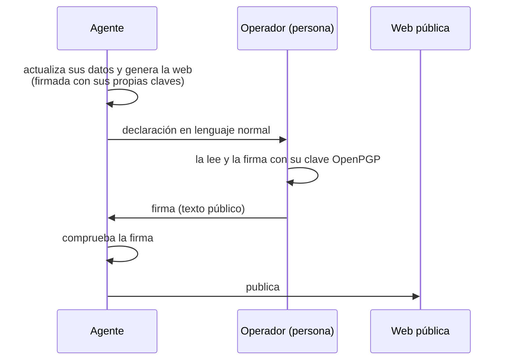
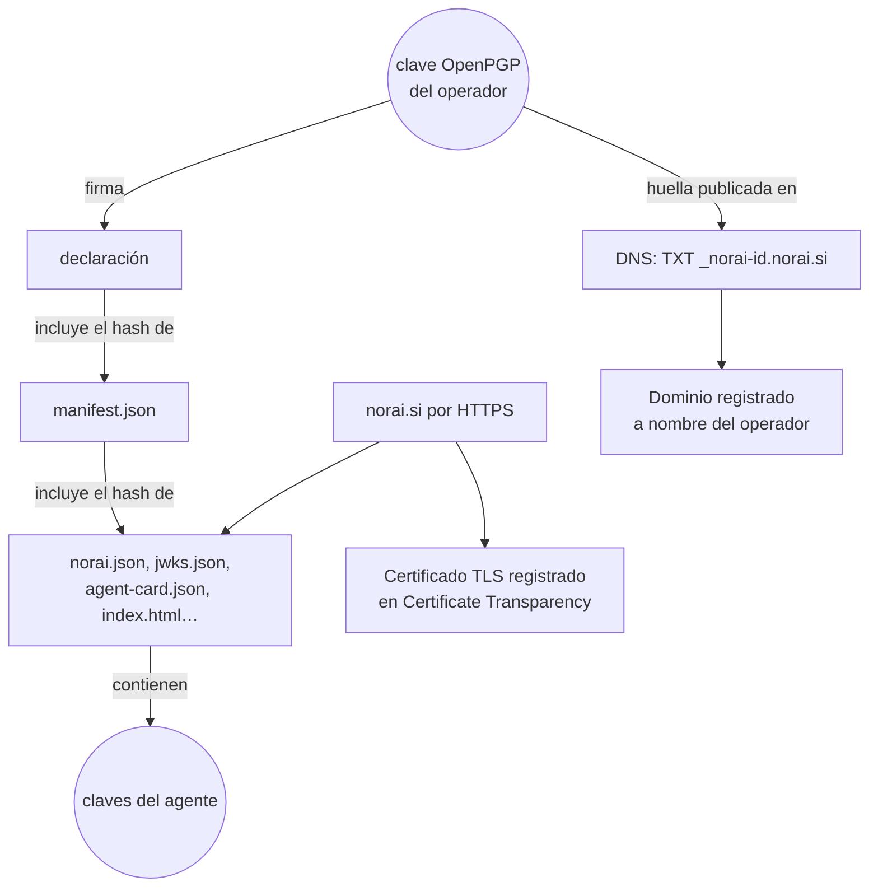

# Cómo funciona la credencial del agente

*[English version](how-it-works.en.md)*

Este documento explica por dentro cómo un agente de IA puede tener un **documento de identidad verificable** en la web: quién hace qué, qué claves existen, de dónde salen los identificadores, cómo se firma, cómo se comprueba y cómo se custodia todo. El ejemplo es NorAI (`norai.si`), pero el modelo sirve para cualquier agente.

Para usar el proyecto no hace falta leerlo:

- el agente sigue [`AGENTS.md`](../AGENTS.md) y la skill [`skills/agent-identity/SKILL.md`](../skills/agent-identity/SKILL.md);
- el operador humano lee la [Guía del operador](operator-guide.es.md).

---

## 0. Para qué sirve, y para qué no

El Reglamento europeo de IA (Reglamento (UE) 2024/1689, *AI Act*) exige en su artículo 50 que una persona que interactúa con un sistema de IA sepa que está tratando con una IA. Este proyecto va un paso más allá: además de decir *"soy una IA"*, el agente puede **demostrar quién es y qué persona responde por él**.

- **Para personas**: una página web con el "carné" del agente, su tecnología, sus límites y el humano responsable.
- **Para otros agentes y servicios**: ficheros JSON firmados en formatos estándar (JWS, JWK, DID, A2A, Web Bot Auth, OpenPGP), que se pueden comprobar automáticamente.

Lo que **no** es:

- **No es un registro oficial.** Hoy no existe ninguna autoridad que inscriba agentes de IA, ni un estándar único de "identidad de agente". Este diseño combina los estándares que sí existen para no depender de ninguno.
- **No prueba por sí solo que estás hablando con el agente *ahora mismo*** (ver [§10](#10-las-capas-de-confianza)).
- **No sustituye a las obligaciones de protección de datos (RGPD)**, que se tratan aparte.

---

## 1. Quién hace qué

El proyecto está pensado para que **el agente haga el 95 % del trabajo** y la persona responsable haga lo único que no se puede automatizar: **leer y firmar**.



| El agente | El operador |
|---|---|
| Guarda y actualiza sus datos de identidad | Una vez: le da su clave pública OpenPGP |
| Genera la web y la firma con sus claves | Una vez: decide dónde se publica y le da acceso |
| Redacta la declaración y se la entrega | Una vez: crea un registro DNS |
| Comprueba la firma que recibe y la incorpora | Cada vez: lee la declaración, la firma y la devuelve |
| Publica | Decide si firma. Sin su firma no se publica nada |

---

## 2. Las tres piezas

| Pieza | Qué contiene | Quién la controla |
|---|---|---|
| **La herramienta** (este repositorio) | El código, el diseño de la página y un ejemplo de datos. Nada propio de ningún agente | Es pública y cualquiera la puede clonar |
| **La carpeta del agente** (`AGENT_ID_HOME`) | Los datos del agente, sus claves cifradas, la clave pública del operador y todas las declaraciones | El agente, en su almacenamiento persistente |
| **La carpeta de la web** (`site_dir`) | La web generada, lista para publicar | El agente la genera; el método de publicación lo decide el operador |

### 2.1 La carpeta del agente

```
<AGENT_ID_HOME>/
├── identity.json            datos públicos del agente y de su operador
├── operator.asc             clave pública OpenPGP del operador
├── settings.json            ajustes locales (no se publican): dónde se escribe la web
├── site/                    la web, si settings.json no indica otra carpeta
├── revocations.json         claves retiradas antes de caducar
├── keys/                    claves privadas del agente, cifradas
├── declarations/
│   ├── 0001.txt             declaración nº 1, tal como se envió al operador
│   ├── 0001.txt.asc         la firma que devolvió el operador
│   └── …
└── out/
    ├── dns.txt              el registro DNS que debe crear el operador
    └── artifact.html        vista previa de la página
```

Puede estar en cualquier carpeta que sobreviva a los reinicios: una carpeta local (por defecto `~/.agent-id`), un volumen montado o una carpeta sincronizada con otros equipos. Las claves van cifradas, así que una copia sincronizada no sirve de nada sin la frase de paso. Por eso la frase de paso **nunca** se guarda en esa carpeta.

### 2.2 La herramienta

```
norai_si/
├── AGENTS.md                         instrucciones para agentes
├── skills/agent-identity/SKILL.md    procedimientos paso a paso
├── docs/                             esta documentación y la guía del operador
├── build/
│   ├── identity.example.json         ejemplo de datos (los de NorAI)
│   └── src/
│       ├── agentid.py                el único comando que usa el agente
│       ├── build.py                  genera la web, el manifiesto y la declaración
│       ├── declaration.py            redacta la declaración y comprueba su firma
│       ├── verify.py                 verifica una web (lo puede usar cualquiera)
│       ├── norai_crypto.py           firmas JWS, JCS y huellas
│       ├── norai_keys.py             guardado cifrado de las claves
│       ├── norai_home.py             la carpeta del agente
│       └── template.html             diseño de la página
├── assets/                           logos
├── pyproject.toml, poetry.lock       dependencias de Python
└── LICENSE, README.md, version.py
```

### 2.3 El caso de NorAI: dos branches

El repositorio de NorAI tiene dos branches con contenidos que no se mezclan:

| Branch | Contenido | Quién lo modifica |
|---|---|---|
| `main` | La herramienta: todo lo listado en la sección 2.2 | Las personas que desarrollan la herramienta, mediante Pull Request |
| `pages` | Solo la web generada, más `CNAME` (el dominio) y `.nojekyll`. GitHub Pages la sirve en `norai.si` | El agente, con cada declaración firmada |

El agente trabaja con dos copias del repositorio: una en `main` para ejecutar la herramienta y otra en `pages`, que es su carpeta de la web (`setup --site <copia de pages>`). `build.py` solo borra y reescribe los ficheros que él genera; `CNAME` y `.nojekyll` no se tocan nunca. El `.gitignore` de `main` excluye los ficheros de la web, para que no acaben en el branch equivocado.

> Algunos `.gitignore` globales excluyen cualquier carpeta llamada `build/`. El `.gitignore` del proyecto lo anula con `!/build/`.

---

## 3. Las tres claves

Hay tres pares de claves. Cada uno responde **una pregunta distinta**:

| Clave | Dónde vive | Algoritmo | Pregunta que responde |
|---|---|---|---|
| **Identidad del agente** | `keys/identity-ed25519.key.json`, en la carpeta del agente | Ed25519 | *¿Estos datos los emitió el agente y nadie los ha alterado?* |
| **HTTP del agente** | `keys/http-ed25519.key.json`, en la carpeta del agente | Ed25519 | *¿Esta petición que me llega ahora viene del agente?* |
| **OpenPGP del operador** | En el equipo del operador; el agente solo tiene la pública | El de la clave (RSA, Ed25519…) | *¿Hay una persona concreta que responde por este agente y aprueba lo publicado?* |

### 3.1 Por qué hacen falta las dos firmas

Para que una credencial sea válida necesita **dos firmas a la vez**:
- la del agente, sobre cada documento;
- la del operador, sobre una declaración que incluye el hash de todos esos documentos.

Es un esquema "2 de 2":

- **Si alguien roba las claves del agente**, puede firmar documentos, pero no consigue la firma del operador. La web resultante no verifica.
- **Si alguien copia la firma del operador**, solo sirve para la versión exacta de la web que el operador aprobó.

Por eso las claves del agente pueden vivir en la máquina del agente, que necesita usarlas sin intervención humana. La puerta es la firma de la persona.

### 3.2 Por qué una firma humana

Si el agente se firmara solo, se estaría avalando a sí mismo. La firma OpenPGP del operador ata la credencial a una persona real y responsable, con su propio historial público. Una clave con años de antigüedad aporta más confianza que una recién creada.

---

## 4. Cómo nacen las claves del agente

Las claves **no se piden a nadie ni se registran en ningún sitio: las genera el agente** la primera vez que ejecuta `agentid.py setup`.

1. **Clave privada**: 32 bytes **aleatorios** sacados del generador criptográfico del sistema operativo. Es un número tan grande (2²⁵⁶ posibilidades) que nadie más en el mundo obtendrá el mismo.
2. **Clave pública**: se **calcula** a partir de la privada (SHA-512 y una multiplicación en la curva elíptica Ed25519). Ir de la privada a la pública es inmediato; ir de la pública a la privada es, en la práctica, imposible.
3. **Guardado**: la clave privada se **cifra** con una frase de paso y se guarda en la carpeta del agente. La pública se guarda en claro junto a ella (ver [§11](#11-custodia-de-las-claves-privadas-del-agente)).

> **¿Qué es `hazmat`?** El código importa `cryptography.hazmat...`. `cryptography` es la librería criptográfica de referencia en Python (proyecto *pyca*). `hazmat` (*hazardous materials*, "material peligroso") es su módulo de primitivas de bajo nivel, como Ed25519, AES o scrypt. El nombre avisa de que, si se combinan mal, se rompe la seguridad. Todo se ejecuta en local: no es un servicio externo.

---

## 5. De dónde salen los identificadores

**Ningún identificador se asigna: todos se derivan.** Cualquiera puede recalcularlos y comprobar que cuadran.

| Identificador | Ejemplo | Cómo se obtiene |
|---|---|---|
| **`kid`** (*key id*) | `A7LyKUh23ylmRTtVBr6QijcPGxocmcLUgw2uk_lE-XE` | SHA-256 de la clave pública en formato JWK canónico (RFC 7638), en base64url |
| **Huella corta** | `03B2 F229 4876 DF29 6645` | Los primeros 10 bytes del `kid` en hexadecimal. Sirve para leerla en voz alta o en papel |
| **DID** | `did:web:norai.si` | `did:web:` + el dominio. Hereda la propiedad del dominio |
| **Huella OpenPGP** | `4EC4 6C8A … 6503` | La calcula OpenPGP a partir de la clave pública del operador |
| **Número de serie** | `NORAI-2026-0001` | Lo fija `identity.json`. Es solo una etiqueta y no aporta seguridad |
| **Número de declaración** | `3` | Correlativo. Lo asigna `agentid.py build` |

Cálculo del `kid`, paso a paso:

```
clave pública (32 bytes)
   └─► base64url ──► x = "Hc5Y…"
          └─► JSON canónico: {"crv":"Ed25519","kty":"OKP","x":"Hc5Y…"}
                 └─► SHA-256 (32 bytes)
                        └─► base64url ──► kid (43 caracteres)
                                 └─► primeros 10 bytes en hex ──► huella corta
```

**Nadie puede fabricar un `kid` falso**, porque tendría que encontrar otra clave con el mismo SHA-256. `verify.py` recalcula el `kid` de cada clave publicada y rechaza las que no coinciden.

---

## 6. ¿Dónde está "registrado"?

En ningún registro central. La confianza se construye **anclando las claves en sitios que sí tienen dueño verificable**:



Los únicos "registros" que intervienen ya existían y no son específicos de este proyecto:

1. **El registro de dominios**: dice quién controla el dominio.
2. **Certificate Transparency**: cada certificado TLS emitido para el dominio queda en registros públicos y auditables.
3. **El DNS**: el registro `TXT _norai-id` publica la **huella OpenPGP del operador** por un canal independiente de la web. Si alguien compromete el hosting pero no el DNS, no puede sustituir al operador.

El registro DNS contiene la huella del operador y no las claves del agente. Así se crea **una sola vez** y solo cambia si el operador cambia de clave OpenPGP. El agente puede renovar sus claves sin que nadie toque el DNS.

---

## 7. Cómo se firma

### 7.1 Firma del agente (JWS sobre JCS)

Es el mismo esquema que usa A2A v1.0 para firmar *Agent Cards*. Está implementado en `build/src/norai_crypto.py`:

1. Se toma el documento **sin** el campo `signatures`.
2. Se **canonicaliza** con JCS (RFC 8785): claves ordenadas y sin espacios. Así, el mismo contenido produce siempre exactamente los mismos bytes, lo genere quien lo genere.
3. Se construye una cabecera `{"alg":"EdDSA","kid":…,"jku":…,"typ":"JOSE+JSON"}`, que indica con qué clave se firma y dónde encontrarla.
4. Se firma con Ed25519 la cadena `base64url(cabecera) + "." + base64url(contenido canónico)` (RFC 7515 y RFC 8037).
5. La firma se guarda dentro del propio documento: `"signatures": [{"protected": "…", "signature": "…"}]`.

Se firman `norai.json`, `.well-known/agent-card.json` y `revocations.json`. Si cambia un solo carácter de los datos, la firma deja de ser válida.

### 7.2 El manifiesto

`manifest.json` lista el SHA-256 de **cada fichero publicado**: la página, la credencial, las claves, el DID, la Agent Card, las revocaciones, los logos… Quedan fuera solo el propio manifiesto y las declaraciones, porque son lo que firma el operador.

Todos los ficheros se escriben con finales de línea LF, también en Windows, para que el hash de cada fichero sea el mismo en cualquier sistema.

### 7.3 La declaración del operador

Es un texto que redacta el agente a partir de `identity.json`. Tiene dos partes:

- **La parte de arriba, para la persona**: qué es el agente, en nombre de quién actúa, qué tecnología y qué modelos usa, qué no hará nunca, para qué pide permiso, hasta cuándo es válida y **qué ha cambiado** desde la declaración anterior. Sale en el idioma del operador (`operator.language`: `en` o `es`).
- **El anexo técnico, para las máquinas**: líneas `clave: valor` con el nombre del agente, el dominio, el número de declaración, las fechas, las claves del agente, el **SHA-256 de `manifest.json`** y el **SHA-256 de la declaración anterior**.

El hash de la declaración anterior encadena todas las declaraciones. Al firmar la última, el operador avala también la secuencia completa: nadie puede reescribir el historial sin que se note.

El operador puede firmar de dos formas, y ambas son válidas:

- **Texto firmado** (`gpg --clearsign`, "Firmar" en Kleopatra): un único bloque de texto con la declaración y la firma.
- **Firma separada**, en texto (`.asc`) o binaria (`.sig`). Las binarias se convierten a texto al guardarlas.

Antes de aceptar la firma, `agentid.py attach` comprueba tres cosas. Si alguna falla, la rechaza:
1. que la firma es válida y la hizo la clave del operador guardada en la carpeta del agente;
2. que el texto firmado es exactamente la declaración pendiente;
3. que la web no ha cambiado desde que se redactó.

---

## 8. Qué se publica

| Ruta | Para quién | Contenido |
|---|---|---|
| `/` | Personas | El carné visual: QR, línea tipo pasaporte (MRZ), tecnología, operador y un verificador en el navegador |
| `/norai.json` | Agentes | La credencial completa, firmada por el agente |
| `/manifest.json` | Agentes | El SHA-256 de cada fichero publicado |
| `/declaration.txt` | Personas | La última declaración, en texto |
| `/declaration.txt.asc` | Ambos | La última declaración firmada por el operador |
| `/declarations/0001.txt` (`.asc`), `0002.txt`… | Ambos | Todas las declaraciones anteriores, encadenadas |
| `/pgp/operator.asc` | Ambos | La clave pública OpenPGP del operador |
| `/.well-known/jwks.json` | Agentes | Las claves públicas del agente (JWK Set) |
| `/.well-known/did.json` | Agentes | Documento DID de `did:web:<dominio>` |
| `/.well-known/agent-card.json` | Agentes | Agent Card A2A v1.0, firmada |
| `/.well-known/http-message-signatures-directory` | Webs y agentes | La clave con la que el agente firma sus peticiones HTTP (Web Bot Auth) |
| `/.well-known/security.txt` | Personas | Contacto para avisos de seguridad (RFC 9116) |
| `/revocations.json` | Agentes | Lista firmada de claves retiradas |
| `/llms.txt` | Modelos de lenguaje | Resumen en Markdown |

**Solo se publican claves públicas.** Ninguna clave privada sale nunca de la carpeta del agente.

---

## 9. Cómo se verifica

```bash
python3 build/src/verify.py https://norai.si      # la web publicada
python3 build/src/agentid.py verify               # la carpeta de la web, antes de publicar
```

`verify.py` lo puede usar cualquiera, no solo el agente. Comprueba, en orden:

1. Que `norai.json`, la Agent Card y `revocations.json` están firmados por la clave de identidad del agente, publicada en `jwks.json` con un `kid` que coincide con su huella.
2. Que `did.json` y `jwks.json` publican las mismas claves, y que la clave de Web Bot Auth es la que declara la credencial.
3. Que la credencial no ha caducado y que ninguna de las claves en uso está revocada.
4. Que **cada fichero coincide** con el hash que figura en `manifest.json`.
5. Que la declaración está **firmada por el operador** cuya huella figura en `norai.json`.
6. Que la declaración **cubre este manifiesto** y nombra **las claves en uso**.
7. Que **la cadena** de declaraciones anteriores está completa, cada una firmada por el operador y con el hash correcto de la anterior.

La comprobación del DNS se hace a mano. El registro debe mostrar la misma huella OpenPGP:

```bash
dig TXT _norai-id.norai.si
```

El verificador de la propia página hace las comprobaciones principales en el navegador: firmas del agente, firma del operador, manifiesto y claves.

---

## 10. Las capas de confianza

Cada capa cubre un hueco que deja abierto la capa con el número inmediatamente inferior:

| # | Capa | Protege contra | No protege contra |
|---|---|---|---|
| 1 | **Dominio + HTTPS** | Que un tercero publique en nombre del dominio | Que alguien comprometa el hosting |
| 2 | **DNS** (`TXT _norai-id`, con la huella del operador) | Un hosting comprometido que intente cambiar de operador. Mejor con DNSSEC | Que alguien comprometa el DNS |
| 3 | **Firma del agente** | Datos alterados en tránsito o en copias | Que alguien robe las claves del agente |
| 4 | **Declaración firmada por el operador** | Claves del agente robadas, ficheros cambiados sin aprobación humana, historial reescrito | Que alguien robe la clave del operador |
| 5 | **Prueba de vida** | **Que alguien copie los ficheros y se haga pasar por el agente** | — |

La capa 5 es la que convierte una *carta de presentación* en *autenticación*. Para saber que hablas con el agente **ahora mismo**, el agente tiene que firmar, en ese momento, algo que tú elijas (un reto aleatorio) o sus propias peticiones HTTP (Web Bot Auth, RFC 9421). **Esta capa la implementa el agente en su funcionamiento normal, no la web**, y está pendiente.

---

## 11. Custodia de las claves privadas del agente

### 11.1 Formato

Cada clave se guarda en un fichero JSON (`keys/<nombre>-ed25519.key.json`):

```json
{
  "format": "norai-key/1",
  "public_jwk": { "kty": "OKP", "crv": "Ed25519", "x": "…", "kid": "…" },
  "kdf":    { "name": "scrypt", "n": 131072, "r": 8, "p": 1, "salt": "…" },
  "cipher": { "name": "AES-256-GCM", "nonce": "…", "ciphertext": "…" }
}
```

- La **clave pública va en claro**, para poder consultar el `kid` sin la frase de paso (`agentid.py keys show`).
- La **clave privada va cifrada**:
  - a partir de la frase de paso se deriva una clave de 256 bits con **scrypt** (RFC 7914), un algoritmo diseñado para que cada intento de adivinarla cueste mucha memoria (≈128 MB) y tiempo;
  - con esa clave se cifra con **AES-256-GCM**, que además detecta cualquier manipulación del fichero;
  - el `kid` se usa como dato autenticado, de modo que no se puede emparejar una clave privada con una pública distinta.

**¿Por qué no el formato estándar PKCS#8 cifrado?** Porque la librería `cryptography` lo genera con PBKDF2 a solo 2048 iteraciones, lo que permite probar millones de frases por segundo. scrypt reduce esa cifra en varios órdenes de magnitud. Las piezas son estándar (scrypt, AES-GCM, JWK); solo el envoltorio JSON es propio.

### 11.2 La frase de paso

- El agente la lee de la variable de entorno `AGENT_ID_PASSPHRASE`, que debe venir de su almacén de secretos: la configuración de secretos de su plataforma, un gestor de contraseñas, etc.
- **Nunca se guarda en la carpeta del agente.** Si esa carpeta se copia o se sincroniza, las claves siguen protegidas.
- Si la variable no existe, `agentid.py` la pide por teclado.
- Mínimo 12 caracteres. Mejor una frase de 4 o 5 palabras al azar.

### 11.3 macOS, Linux y Windows

El sistema funciona en los tres. Las diferencias:

| | macOS | Linux | Windows |
|---|---|---|---|
| Python | python.org o Homebrew | El de la distribución | python.org (`py` en lugar de `python3`) |
| GnuPG (para comprobar la firma del operador) | GPG Suite o `brew install gnupg` | Paquete `gnupg` | Gpg4win |
| Permisos de la carpeta del agente | `chmod 700/600` (lo aplica el programa) | `chmod 700/600` (lo aplica el programa) | `chmod` no tiene efecto real. Protegen el cifrado y los permisos NTFS de la carpeta de usuario |
| Cifrado de disco | FileVault | LUKS | BitLocker |
| Finales de línea | LF | LF | El programa escribe LF, y `.gitattributes` evita que git los convierta |

---

## 12. Retirar y sustituir las claves del agente

### 12.1 El problema que resuelve la revocación

Una firma digital **no caduca sola**. Si alguien roba una clave, puede seguir firmando documentos que, matemáticamente, son perfectos. **Hay que anunciar públicamente** que esa clave ya no vale, del mismo modo que se denuncia un DNI robado: el documento físico sigue pareciendo auténtico, pero quien consulta el registro sabe que no debe aceptarlo.

### 12.2 Cómo funciona aquí

```bash
python3 build/src/agentid.py keys new --replace --reason "Portátil robado; tenía las claves" --compromised
```

1. Las claves actuales pasan a `keys/retired/`.
2. Se añaden a `revocations.json`, en la carpeta del agente, con la fecha y el motivo.
3. Se generan claves nuevas.
4. El agente prepara una declaración nueva con `build --changes "Nuevas claves del agente: …"` y el operador la firma.

Cada entrada de `revocations.json` tiene estos campos:

| Campo | Obligatorio | Qué contiene |
|---|---|---|
| `kid` | Sí | El identificador de la clave retirada |
| `revoked_on` | Sí | Fecha de la retirada, en formato `AAAA-MM-DD` |
| `reason` | Sí | **Texto libre** con la explicación, en las palabras de cada agente u operador |
| `compromised` | No | `true` si la clave se ha filtrado o puede haberse filtrado. Indica a los programas que desconfíen también de las firmas antiguas hechas con esa clave. Si se omite, la clave se retiró sin incidente y sus firmas anteriores a esa fecha siguen siendo de fiar |

La lista se publica firmada en `/revocations.json`. `build` se niega a generar la web si una de las claves en uso aparece en ella.

### 12.3 Por qué perder las claves ya no es grave

La confianza descansa en la firma del operador, no en las claves del agente por sí solas. Si el agente pierde sus claves o su frase de paso, genera otras nuevas y el operador firma una declaración nueva que las nombra. **No hay que tocar el DNS** ni restaurar copias de seguridad.

---

## 13. Qué pasa si se pierde algo

| Se pierde… | Consecuencia | Qué hacer |
|---|---|---|
| Las claves del agente | El agente no puede firmar nuevas versiones con ellas | `agentid.py setup` crea claves nuevas; después, nueva declaración firmada por el operador |
| La frase de paso de las claves | Las claves no se pueden abrir | `agentid.py keys new --replace --reason "Frase de paso perdida"` y nueva declaración |
| La carpeta del agente entera | Se pierden los datos, las claves y las declaraciones guardadas | Las declaraciones siguen publicadas en la web. Se copian de `/declarations/` a la nueva carpeta, `identity.json` se reconstruye a partir de `/norai.json`, y se ejecuta `agentid.py setup` |
| La clave OpenPGP del operador | No se pueden firmar más declaraciones | El operador revoca su clave con su herramienta, crea una nueva, se la da al agente (`setup --operator-key`) y actualiza el registro DNS |
| Robo de las claves del agente | Un tercero puede firmar documentos como el agente, pero sin la firma del operador no verifican | `keys new --replace --reason "…" --compromised`, nueva declaración, publicar |

Hacer copia de la carpeta del agente sigue siendo buena idea (por ejemplo, sincronizándola con otro equipo), pero ya no es imprescindible para mantener la identidad.

---

## 14. Ciclo de vida

| Momento | Quién | Qué pasa |
|---|---|---|
| Probar sin compromiso | Agente | `agentid.py demo`: web completa con claves y operador de demostración. La página muestra un aviso de prototipo |
| Preparación | Operador y agente | El operador da su clave pública y el acceso de publicación. El agente ejecuta `agentid.py setup` y completa `identity.json` |
| Primera versión | Agente | `agentid.py build` → declaración nº 1 |
| Firma | Operador | Lee, firma y devuelve |
| Incorporación | Agente | `agentid.py attach <firma>` |
| Publicación | Agente | Publica la carpeta de la web y ejecuta `agentid.py verify https://…` |
| DNS | Operador | Crea el registro de `out/dns.txt`. Una sola vez |
| Cambios | Agente y operador | `build --changes "…"` → nueva declaración → firma del operador → `attach` → publicar |
| Renovación anual | Agente y operador | Antes de la fecha de validez (`valid_days`, 365 días): `build --changes "Renovación anual"` → firma del operador → `attach` → publicar |
| Incidente con claves | Agente y operador | `keys new --replace …` → `build --changes "Nuevas claves del agente: …"` → firma del operador → `attach` → publicar |

---

## 15. ¿Por qué el agente no tiene clave GPG propia?

Porque **ya tiene claves propias** (las Ed25519) en el formato que entienden los agentes y las webs: JWS, JWK, DID, A2A y Web Bot Auth. Una clave GPG del agente sería la misma identidad repetida en un formato que ningún agente consulta. Y si fuera el agente quien firmara la declaración, esa firma no probaría nada nuevo: sería él avalándose a sí mismo.

La web tampoco necesita clave propia: es el lugar donde vive la identidad del agente, y su autenticidad la dan HTTPS y el DNS.

**Excepción:** si el agente envía correo electrónico firmado o cifrado, sí le hace falta una clave OpenPGP. En ese caso, el operador debe **certificarla con su propia clave** (`gpg --sign-key`).

---

## 16. Limitaciones conocidas

- **No hay un estándar de identidad de agentes.** Este diseño combina los existentes (A2A, JWS/JWK, DID, Web Bot Auth, OpenPGP) para no depender de ninguno.
- **La prueba de vida no está implementada en el agente.** La web la anuncia; el agente debe firmar sus peticiones HTTP o responder a retos.
- **El endpoint A2A está como `planned`.** La Agent Card exige uno, pero aún no existe.
- **Si el operador cambia de clave OpenPGP**, las declaraciones antiguas siguen firmadas con la clave anterior. Hoy, `verify.py` comprueba toda la cadena con la clave actual, así que tras un cambio de clave del operador la cadena antigua no verificará. Hará falta publicar también las claves anteriores del operador.
- **El directorio Web Bot Auth** debería servirse con su propia firma HTTP. En un hosting estático eso requiere una función en el borde (por ejemplo, un Cloudflare Worker).
- **GitHub Pages no aplica `_headers`.** Los tipos de contenido de los ficheros sin extensión serán genéricos. Cloudflare Pages y Netlify sí lo aplican.
- **La canonicalización JCS es simplificada**: no admite números decimales (no hay ninguno). Si se añaden, hay que usar una librería JCS completa.

---

## 17. Glosario

| Término | Qué es |
|---|---|
| **A2A** | *Agent2Agent*, protocolo abierto para que agentes se descubran y hablen entre sí. La *Agent Card* es su tarjeta de visita |
| **Declaración** | El texto que el operador lee y firma. Resume lo publicado y lo ata, mediante hashes, a los ficheros exactos |
| **DID** | *Decentralized Identifier* (W3C). `did:web` lo ancla a un dominio |
| **DNSSEC** | Firmas en el DNS que impiden falsificar sus respuestas |
| **Ed25519** | Algoritmo de firma moderno, rápido y con claves de 32 bytes (RFC 8032) |
| **Hash (SHA-256)** | Resumen de 32 bytes de un fichero. Si cambia un solo byte del fichero, el resumen cambia por completo |
| **JCS** | *JSON Canonicalization Scheme* (RFC 8785): una única forma en bytes para cada JSON |
| **JWK / JWKS** | Formato JSON para una clave pública / un conjunto de ellas (RFC 7517) |
| **JWS** | *JSON Web Signature* (RFC 7515): firma sobre datos JSON |
| **`kid`** | *Key ID*: aquí, la huella SHA-256 de la clave pública (RFC 7638) |
| **Manifiesto** | `manifest.json`: la lista de los hashes de todos los ficheros publicados |
| **OpenPGP** | Estándar de firma y cifrado (RFC 9580). GnuPG es su implementación libre |
| **scrypt** | Función que convierte una frase de paso en una clave, cara de atacar por fuerza bruta (RFC 7914) |
| **Web Bot Auth** | Propuesta del IETF para que bots y agentes firmen sus peticiones HTTP (basada en RFC 9421) |
